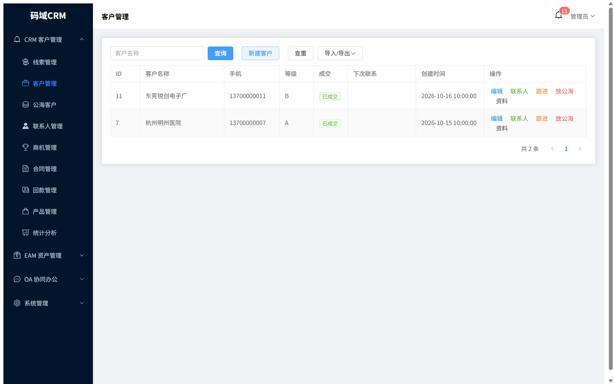
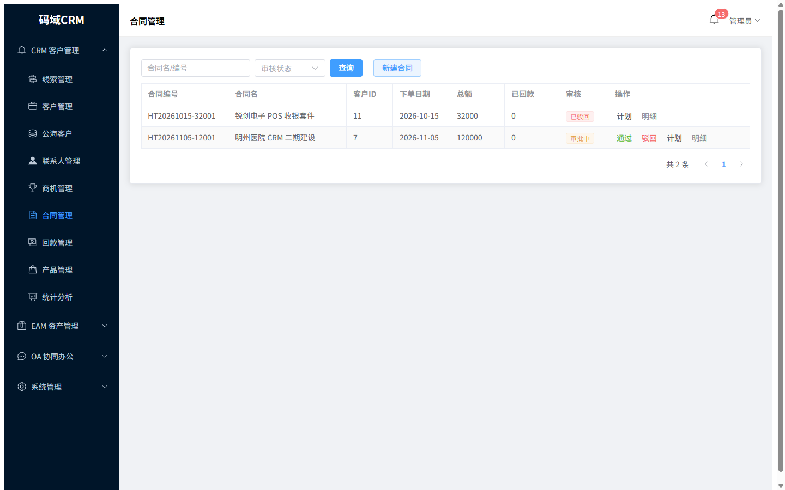
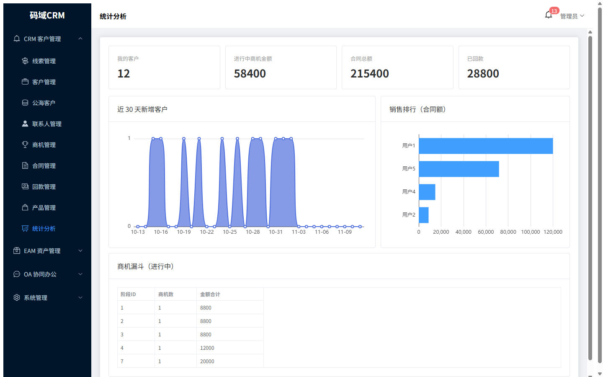
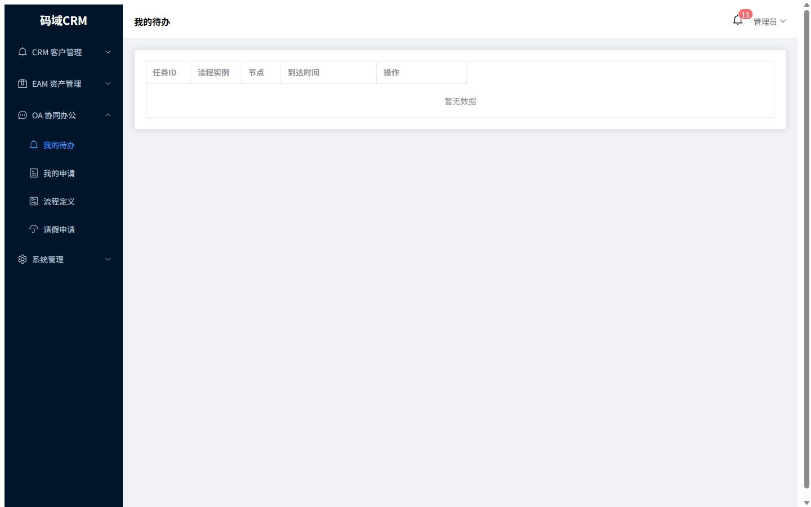
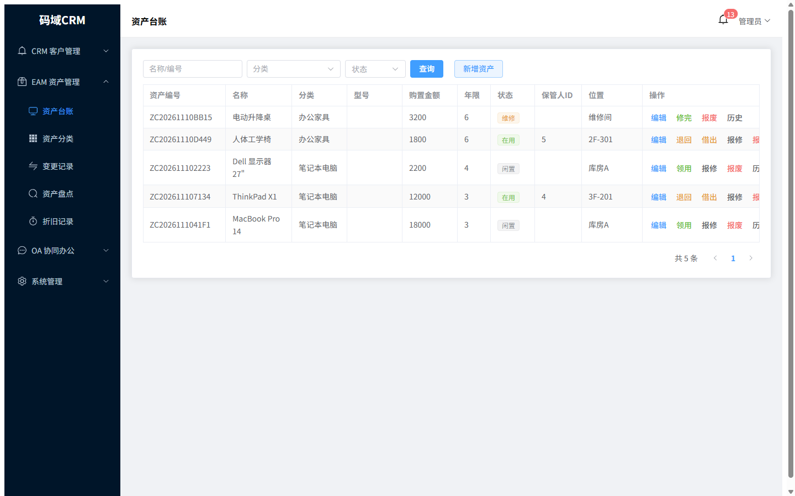
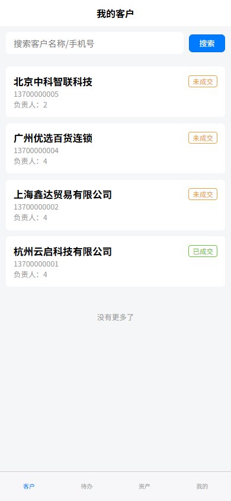

# 码域CRM (MaoyuCRM)

> CRM 客户管理 + OA 协同审批 + EAM 资产管理 —— 一套开箱可用的企业一体化经营管理系统


**[在线演示](https://crm.hefeicode.com)** · **[产品手册 PDF](https://crm.hefeicode.com/manual.pdf)** · **[云服务报价](https://crm.hefeicode.com/pricing.pdf)**

演示账号（每日自动重置，放心操作）：

| 账号 | 密码 | 角色 |
|------|------|------|
| admin | admin123 | 超级管理员（全部功能） |
| zhang3 | admin123 | 销售经理（合同审批/流程定义） |
| wang5 | admin123 | 销售员（跟进/提审/资产领用） |
| finwu | admin123 | 财务（回款审批） |
| hrzhou | admin123 | 人事（请假审批/用户管理） |
| guest | admin123 | 只读（权限对照） |

---

## 它能干什么

```
市场获客 ──→ 销售跟进 ──→ 商机推进 ──→ 合同签订 ──→ 回款闭环
   │            │            │            │            │
  线索        客户/公海      阶段/赢单    明细/审批     计划/审批/累计
   └────────────┴──── OA 审批流（或签/会签/条件分支）────┴──── EAM 资产（领用/盘点/折旧）
```

**三大中心，不是三套系统拼凑** —— 一个代码库、一套账号、数据实时互通：

| 中心 | 核心能力 |
|------|----------|
| **CRM 客户管理** | 线索（6 来源、一键转客户自动迁移跟进）、客户（查重合并、团队三级数据权限、公海 + 掉保/超期自动回收）、联系人（决策角色）、商机（阶段组推进、赢单联动成交）、产品、合同（明细行、状态机）、回款（计划、超额硬拦截）、Excel 导入导出、统计驾驶舱 |
| **OA 协同审批** | 自研轻量审批引擎（3 张表，无 Flowable 重依赖）：或签 / 会签 / 按金额条件自动路由；合同、回款、请假、资产报废自动进流程；站内信 + 阿里云短信双通道提醒；全程轨迹留痕、支持撤回 |
| **EAM 资产管理** | 台账（编号自动生成）、领用/退回/借出/归还全状态机留痕、报修闭环、报废走审批、部门/全量盘点差异对比、直线法月度折旧自动计提（5% 残值、提完即停） |

**三端同步**：PC 管理端（Vue3 + Element Plus）/ 手机 H5（uni-app）/ 微信小程序 —— 全部源码开放。

## 界面预览（真实系统截图）

| 客户管理 | 合同台账 |
|---|---|
|  |  |

| 统计驾驶舱 | 审批待办 |
|---|---|
|  |  |

| 资产台账 | 手机端 |
|---|---|
|  |  |

## 30 秒跑起来（Docker）

```bash
git clone https://github.com/你的组织/maoyu-crm.git
cd maoyu-crm
./docker/deploy-docker.sh
# 打开 http://服务器IP:8090  账号 admin / admin123
```

源码方式部署见 [docs/部署指南.md](docs/部署指南.md)（环境准备 / 数据库初始化 / nginx + HTTPS / 小程序发布全流程）。

## 技术栈

**后端**：Spring Boot 2.7 · JDK 8 · MyBatis-Plus · Sa-Token · MySQL 5.7+ · Redis（可选）
**PC 端**：Vue 3 · Element Plus · pinia · ECharts · Vite
**移动端**：uni-app（Vue 3）—— H5 / 微信小程序 / APP

```
maoyu-crm/
├── freecrm-common    公共基座（R 响应 / BaseEntity / 审批回调接口）
├── freecrm-system    RBAC 权限 / 站内信 / 阿里云短信 / 操作日志 / 登录日志
├── freecrm-crm       CRM 全业务（含公海回收定时任务）
├── freecrm-oa        审批流引擎（或签/会签/条件分支）
├── freecrm-eam       资产管理（状态机/盘点/折旧）
├── freecrm-server    Spring Boot 装配（端口 48100）
├── freecrm-web       PC 管理端（27 页）
├── freecrm-app       移动端（H5 + 小程序，9 页）
└── sql/              全量建表脚本 + 可重导演示数据
```

模块职责 / 审批引擎设计 / 横切约定见 [docs/代码说明.md](docs/代码说明.md)。

## 与同类开源 CRM 对比

| 能力 | 码域CRM | 悟空CRM 11 | 一般开源 CRM |
|------|:---:|:---:|:---:|
| CRM 全链路（线索→回款） | ✅ | ✅ | 部分 |
| 内置审批流引擎 | ✅ 或签/会签/条件分支 | ✅ | ❌ 常需外接 |
| 资产管理（盘点/折旧） | ✅ | ❌ | ❌ |
| 团队数据权限（负责人/可写/只读） | ✅ | 部分 | ❌ |
| 公海自动回收（掉保/超期） | ✅ 可配 | 部分 | ❌ |
| 移动端源码（H5+小程序） | ✅ | 部分 | ❌ |
| Docker 一键部署 | ✅ | 需自配 | 看项目 |
| 协议 | AGPL-3.0 | 付费授权限制 | 各异 |
| 依赖体量 | 轻量（无 Flowable/无租户表） | 重 | — |

## 开源协议与商用

- 本项目采用 **AGPL-3.0** 开源（见 [LICENSE](LICENSE)）：**企业内部使用、修改、自部署永久免费**；将修改后的代码以网络服务形式对外提供，需按 AGPL 开源你的修改。
- **闭源商用 / OEM 贴牌 / 去除版权标识** 需购买商业授权，联系方式：
  - 邮箱：**348818683@qq.com**
  - 微信：**348818683**（同号）
- 第三方依赖均为宽松许可（Apache-2.0 / MIT / MulanPSL），详见 [THIRD-PARTY-NOTICES.md](THIRD-PARTY-NOTICES.md)。

## 参与贡献

欢迎 Issue 与 PR。**提交 PR 即表示同意将贡献代码的版权归属本项目主体**（用于 AGPL 与商业双许可发行），详见 [CONTRIBUTING.md](CONTRIBUTING.md)。

如果这个项目帮到了你，点个 Star 是对作者最大的鼓励 ⭐
